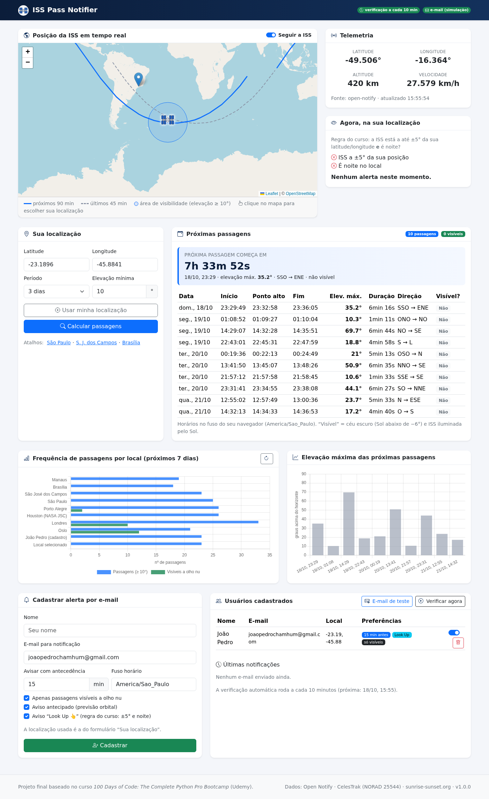
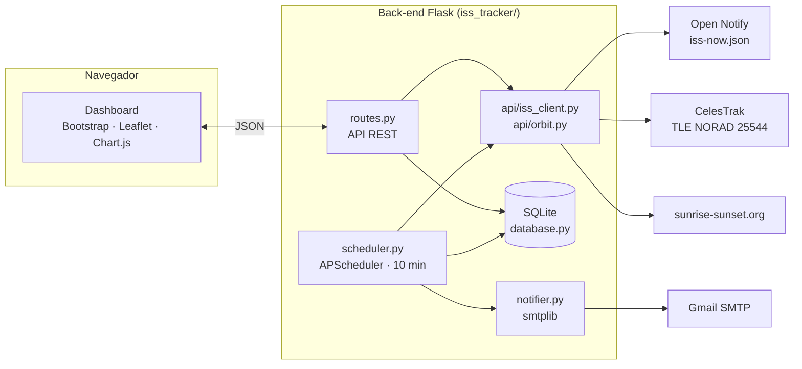

# 🛰️ ISS Pass Notifier

Aplicação web em **Flask** que mostra a Estação Espacial Internacional (ISS) em tempo real,
prevê quando ela vai passar sobre a localização do usuário e **envia um aviso por e-mail**
antes da passagem.

Projeto final desenvolvido a partir do curso
**[100 Days of Code: The Complete Python Pro Bootcamp](https://www.udemy.com/course/100-days-of-code/)**
(Udemy), expandindo o projeto *ISS Overhead Notifier* (Dia 33) para uma aplicação web completa.
O projeto faz parte das Atividades Complementares do curso de **Engenharia Aeroespacial**.



---

## Sumário

- [Funcionalidades](#funcionalidades)
- [Arquitetura](#arquitetura)
- [Estrutura do projeto](#estrutura-do-projeto)
- [Instalação](#instalação)
- [Configuração do e-mail](#configuração-do-e-mail)
- [Como usar](#como-usar)
- [API REST](#api-rest)
- [Como a previsão funciona](#como-a-previsão-funciona)
- [Testes](#testes)
- [Segurança](#segurança)
- [Créditos](#créditos)

---

## Funcionalidades

| Área | O que faz |
|---|---|
| **Mapa em tempo real** | Posição da ISS atualizada a cada 5 s, trajetória das últimas 45 min e das próximas 90 min, e a área de onde ela fica visível. |
| **Telemetria** | Latitude, longitude, altitude e velocidade orbital. |
| **Previsão de passagens** | Horário de início, ponto mais alto e fim, elevação máxima, duração, direção (ex.: *NO → SE*) e se a passagem é **visível a olho nu**. |
| **Regra do curso** | Verifica "agora" se a ISS está a ±5° da sua posição **e** se é noite, como no script original. |
| **Gráficos** | Frequência de passagens em vários locais (Chart.js) e elevação máxima das próximas passagens. |
| **Alertas por e-mail** | Cadastro de usuários (SQLite) com preferências; e-mails enviados com `smtplib`. |
| **Verificação periódica** | APScheduler roda a cada **10 minutos** e envia os avisos sem duplicar. |
| **Interface responsiva** | Bootstrap 5, funciona no celular e no computador. |

Dois tipos de notificação:

1. **Aviso antecipado:** "A ISS vai passar sobre você às 19:42". Usa a previsão orbital e chega
   `N` minutos antes da passagem (padrão: 15).
2. **Look Up 👆:** a regra original do curso. O e-mail sai quando a ISS está a ±5° da sua posição
   e é noite.

Por padrão, as notificações vão para **seu_nome@gmail.com** (configurável em `NOTIFY_EMAIL`).

---

## Arquitetura



---

## Estrutura do projeto

```
.
├── run.py                     # ponto de entrada (servidor + comandos CLI)
├── requirements.txt
├── .env.example               # modelo de configuração (copiar para .env)
├── iss_tracker/
│   ├── __init__.py            # application factory create_app()
│   ├── config.py              # configuração via variáveis de ambiente
│   ├── database.py            # SQLite: usuários e histórico de notificações
│   ├── routes.py              # rotas da página e da API REST
│   ├── notifier.py            # envio de e-mails (smtplib, texto + HTML)
│   ├── scheduler.py           # verificação periódica (APScheduler)
│   ├── api/
│   │   ├── iss_client.py      # chamadas HTTP: posição, TLE, nascer/pôr do sol
│   │   └── orbit.py           # previsão de passagens (Skyfield/SGP4) e cálculos solares
│   ├── templates/             # base.html, index.html (Jinja2)
│   └── static/                # css/, js/, img/
├── tests/                     # 44 testes automatizados (pytest), sem acesso à internet
├── curso/
│   ├── main_original.py       # solução de referência disponibilizada pelo curso
│   └── README.md              # comparação: script do curso × aplicação
├── docs/                      # capturas de tela
└── .github/workflows/tests.yml  # CI: roda os testes a cada push
```

---

## Instalação

Pré-requisito: **Python 3.10 ou superior**.

**Atalho:** rode `./iniciar.sh` (macOS/Linux) ou dê dois cliques em `iniciar.bat` (Windows).
O script cria o ambiente virtual, instala as dependências, cria o `.env` e inicia o servidor.

Passo a passo manual:

```bash
# 1. Clonar o repositório
git clone https://github.com/Joao-Chamhum/iss-pass-notifier.git
cd iss-pass-notifier

# 2. Criar e ativar um ambiente virtual
python -m venv .venv
source .venv/bin/activate          # Windows: .venv\Scripts\activate

# 3. Instalar as dependências
pip install -r requirements.txt

# 4. Criar o arquivo de configuração
cp .env.example .env               # Windows: copy .env.example .env
#    ...e editar o .env com suas credenciais SMTP (ver próxima seção)

# 5. Rodar
python run.py
```

Depois, abra **http://127.0.0.1:8000** no navegador. O banco SQLite (`instance/iss_tracker.db`)
é criado automaticamente na primeira execução.

---

## Configuração do e-mail

O envio usa `smtplib` com STARTTLS. Com Gmail:

1. Ative a **verificação em duas etapas** na conta Google que vai **enviar** os e-mails.
2. Gere uma **senha de app** em <https://myaccount.google.com/apppasswords>.
3. Preencha o `.env`:

```env
SMTP_HOST=smtp.gmail.com
SMTP_PORT=587
SMTP_USER=seu_email_remetente@gmail.com
SMTP_PASSWORD=xxxx xxxx xxxx xxxx      # senha de app (não é a senha da conta)
NOTIFY_EMAIL=seu_nome@gmail.com
```

4. Teste a configuração:

```bash
flask --app run send-test-email
```

ou clique em **"E-mail de teste"** no dashboard.

> Para rodar sem enviar e-mails de verdade, use `EMAIL_DRY_RUN=true`. As mensagens só aparecem no log.

### Variáveis de ambiente

| Variável | Padrão | Descrição |
|---|---|---|
| `SMTP_HOST` / `SMTP_PORT` | `smtp.gmail.com` / `587` | Servidor SMTP |
| `SMTP_USER` / `SMTP_PASSWORD` | — | Credenciais do remetente (**obrigatórias** para enviar) |
| `NOTIFY_EMAIL` | `seu_nome@gmail.com` | Destinatário padrão das notificações |
| `EMAIL_DRY_RUN` | `false` | `true` = só registra no log |
| `SCHEDULER_ENABLED` | `true` | Liga/desliga a verificação automática |
| `CHECK_INTERVAL_MINUTES` | `10` | Intervalo da verificação periódica |
| `DEFAULT_TIMEZONE` | `America/Sao_Paulo` | Fuso usado nos e-mails |
| `DEFAULT_MIN_ELEVATION` | `10` | Elevação mínima (°) para contar uma passagem |
| `DEFAULT_LEAD_MINUTES` | `15` | Antecedência padrão do aviso |
| `SECRET_KEY` | — | Chave do Flask |

---

## Como usar

1. **Escolha sua localização:** digite latitude/longitude, clique no mapa, use
   "Usar minha localização" (GPS do navegador) ou um dos atalhos.
2. Clique em **Calcular passagens** para ver a tabela, a contagem regressiva e os gráficos.
3. Em **Cadastrar alerta por e-mail**, informe seu nome e escolha as preferências:
   antecedência, apenas passagens visíveis, aviso antecipado e/ou aviso "Look Up".
4. Pronto. O agendador verifica a cada 10 minutos e manda o e-mail quando a ISS estiver para passar.
   Você pode pausar, reativar ou remover cadastros na tabela de usuários e forçar uma
   verificação com **Verificar agora**.

Comandos de linha de comando:

```bash
flask --app run init-db            # cria as tabelas (já é feito automaticamente)
flask --app run check              # executa uma verificação imediatamente
flask --app run send-test-email --to outro@email.com
```

---

## API REST

| Método | Rota | Descrição |
|---|---|---|
| `GET` | `/api/iss/now` | Posição atual (lat, lon, altitude, velocidade, fonte) |
| `GET` | `/api/iss/track?before=45&after=90` | Trajetória da ISS (pontos lat/lon por minuto) |
| `GET` | `/api/passes?lat=&lon=&days=3&min_elevation=10` | Próximas passagens sobre o local |
| `GET` | `/api/overhead?lat=&lon=` | Regra do curso: ISS a ±5° + é noite? |
| `GET` | `/api/stats/frequency?days=7` | Nº de passagens (totais e visíveis) por local |
| `GET` / `POST` | `/api/users` | Lista / cadastra usuários |
| `PATCH` / `DELETE` | `/api/users/<id>` | Atualiza preferências / remove usuário |
| `GET` | `/api/notifications` | Histórico de e-mails enviados |
| `POST` | `/api/notify/test` | Envia e-mail de teste |
| `POST` | `/api/check` | Executa a verificação periódica agora |
| `GET` | `/api/status` | Estado do agendador e da configuração de e-mail |

Exemplo de resposta de `/api/passes`:

```json
{
  "count": 10,
  "visible_count": 2,
  "passes": [
    {
      "rise_utc": "2026-10-19T02:29:49+00:00",
      "peak_utc": "2026-10-19T02:32:58+00:00",
      "set_utc": "2026-10-19T02:36:05+00:00",
      "duration_s": 376,
      "max_elevation": 35.2,
      "rise_direction": "SSO",
      "set_direction": "ENE",
      "dark_sky": true,
      "iss_sunlit": false,
      "visible": false
    }
  ]
}
```

---

## Como a previsão funciona

**Posição em tempo real.** Vem da API [Open Notify](http://open-notify.org/Open-Notify-API/ISS-Location-Now/),
a mesma usada no curso, que calcula a posição a partir dos elementos orbitais publicados pela NASA.
Se ela falhar, o sistema tenta a [wheretheiss.at](https://wheretheiss.at/w/developer). Se as duas
falharem, calcula a posição localmente a partir do TLE.

**Elementos orbitais (TLE).** São baixados do [CelesTrak](https://celestrak.org/) (NORAD 25544),
guardados em cache por 6 h e salvos em disco para uso offline.

**Passagens.** A biblioteca [Skyfield](https://rhodesmill.org/skyfield/) propaga a órbita com o
modelo **SGP4** e encontra os instantes em que a ISS sobe acima da elevação mínima, culmina e se põe,
do ponto de vista do observador.

**Visibilidade a olho nu.** A passagem é marcada como visível quando duas condições valem ao mesmo tempo:
- **o céu está escuro**: o Sol está abaixo de −6° (fim do crepúsculo civil);
- **a ISS está iluminada**: ela está fora da sombra da Terra (modelo de sombra cilíndrica).

A posição do Sol é calculada com a fórmula de baixa precisão do *Astronomical Almanac*, sem baixar
efemérides. O modelo de iluminação foi conferido contra a API wheretheiss.at e concordou em 10 de 10 instantes testados.

**Regra do curso.** `is_iss_overhead()` e `is_night()` reproduzem o script original, com uma correção:
o original comparava a hora UTC da API com a hora local da máquina. Veja [`curso/README.md`](curso/README.md).

---

## Testes

```bash
pytest -v
```

São 44 testes que cobrem os parsers das APIs, a regra do curso, a previsão orbital, os cálculos
solares, as rotas, o CRUD no SQLite, o agendador (envio único por passagem) e o fluxo SMTP
(STARTTLS, login e envio, com um servidor simulado). Os testes **não acessam a internet** e
**não enviam e-mails**. O GitHub Actions roda a suíte a cada push, em Python 3.10, 3.11 e 3.12.

---

## Segurança

- Nenhuma credencial fica no código. Tudo é lido do `.env`, que está no `.gitignore`.
- O `.env.example` traz apenas valores de exemplo.
- O banco SQLite (`instance/`) e o cache de TLE também ficam fora do repositório.
- Para Gmail, use sempre uma **senha de app**, nunca a senha principal da conta.

---

## Créditos

- Curso: *100 Days of Code: The Complete Python Pro Bootcamp*, Dra. Angela Yu (Udemy).
- Dados: [Open Notify](http://open-notify.org/), [CelesTrak](https://celestrak.org/),
  [wheretheiss.at](https://wheretheiss.at/), [sunrise-sunset.org](https://sunrise-sunset.org/api).
- Mapas: © [OpenStreetMap](https://www.openstreetmap.org/copyright) via [Leaflet](https://leafletjs.com/).
- Bibliotecas: Flask, Skyfield, APScheduler, Bootstrap, Chart.js.

Licença: [MIT](LICENSE).
